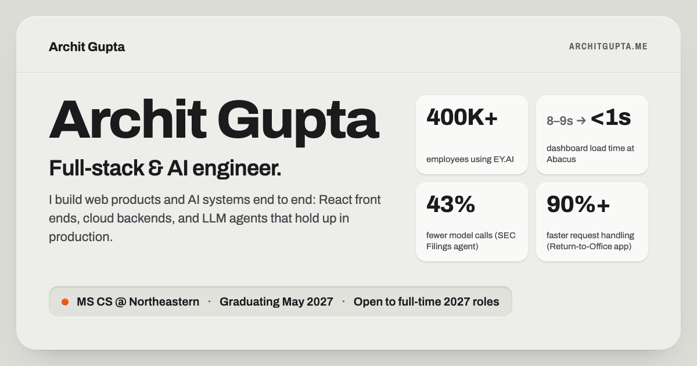

# architgupta.me

Personal portfolio of **Archit Gupta**, full-stack & AI engineer. Built with Astro and Tailwind.

**Live:** [architgupta.me](https://architgupta.me) · **Source:** github.com/archit2901/portfolio



---

## Stack

| Layer | Tech |
|---|---|
| Framework | [Astro 5](https://astro.build/) (static SSG, zero JS by default) |
| Styling | [Tailwind CSS](https://tailwindcss.com/) + CSS custom properties for both themes |
| Language | TypeScript (strict) |
| Fonts | Archivo Variable (weight + width axes), self-hosted |
| Hosting | [Vercel](https://vercel.com/) (static output) |
| SEO | `@astrojs/sitemap`, JSON-LD `Person` schema, OG image |

## Design

"Instrument Faceplate": the site is one calm light-grey panel on a desk. Numbers are readouts and keys, and a single orange key does the important thing (résumé download, current status). Dark mode is the same instrument in graphite. The system follows the OS setting by default and has a switch in the nav. Full design system: [`DESIGN.md`](DESIGN.md). Product context: [`PRODUCT.md`](PRODUCT.md).

## What's in here

- **Home** (`/`): first-viewport faceplate with name, status readout, primary keys and a large 3:4 portrait window, a 6-metric readout strip, then About, Experience, Skills, Projects, Education, FAQ, Contact
- **Metric cross-references**: every metric links to the bullet, section or page that proves it; bullet targets light up via `:target` (collapsed bullets open automatically)
- **Projects archive** (`/projects`) with a category selector
- **`/uses`**, **`/blog`** (placeholder) and a custom **404**
- **`⌘K` command palette**: fuzzy search over sections and actions (résumé, copy email, theme, reduced motion)
- **Keyboard shortcuts**: `g` then `a` / `e` / `s` / `p` / `d` / `f` / `c` jumps to a section, `g h` to the top, `?` opens the palette
- **Copy-to-clipboard** email and section links
- Motion is calm and interaction-only; `prefers-reduced-motion` (and the palette toggle) turns it off

## Content lives in `src/data/`

| File | What |
|---|---|
| `profile.ts` | meta, hero, links, About, Contact |
| `stats.ts` | the metrics readout strip (each metric has an `href` to its proof) |
| `experience.ts` | roles; first 4 bullets visible, the rest collapse |
| `projects.ts` | projects and the featured order |
| `skills.ts`, `education.ts`, `faq.ts`, `uses.ts` | the rest |
| `sections.ts` | section order, nav labels, headings and palette chords |

Components never hardcode copy. Optional fields left `undefined` are hidden.

## Local development

Requires Node 20+.

```bash
npm install
npm run dev          # http://localhost:4321
npm run build        # static output → dist/
npm run preview      # serve the built site locally
npx astro check      # type + diagnostics check
```

The OG image and PNG favicons are rendered from `scripts/og/*.html` (open at 1200×630 / 180×180 and screenshot).

## Deploying

Auto-deploys to Vercel on push to `main`. The [`vercel.json`](vercel.json) at the root pins the framework preset to Astro (overrides any stale dashboard setting) and holds the vanity redirects (`/cv`, `/resume`, `/gh`, `/github`, `/li`, `/linkedin`). CI runs `astro check`, the build, a link check, and Lighthouse (mobile + desktop, 95+ in every category).

## License

Source is public for reference. Please don't re-host as your own portfolio.

---

Built with [Claude Code](https://claude.com/claude-code) as the pairing partner.
